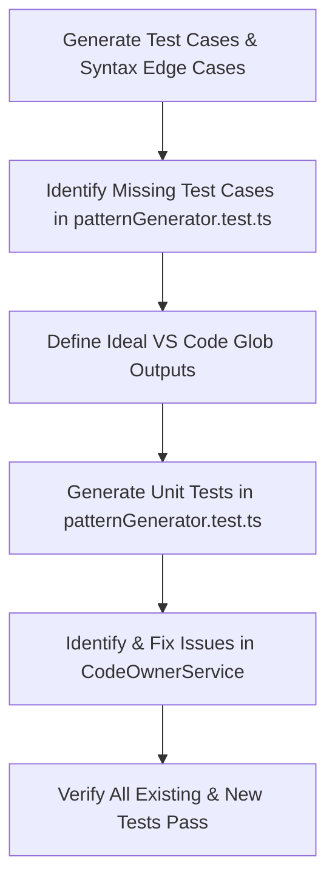

# Implementation Plan: Comprehensive CODEOWNERS Pattern Generation Testing & Fixes

## Goal Description
The goal is to expand the pattern generation test suite in `src/test/patternGenerator.test.ts` by incorporating more test cases.
We will catalog the pattern cases from these specifications, identify all missing cases in `patternGenerator.test.ts`, define the ideal VS Code glob outputs, generate the corresponding unit tests, and fix any discrepancies or bugs discovered in `CodeOwnerService.generateIncludePatterns` and `generateExcludePatterns`.



---

## User Review Required

> [!IMPORTANT]
> **Behavioral Clarifications & Normalizations:**
> 1. **Leading `./` Prefix:**
>    In gitignore / CODEOWNERS syntax, a leading `./` (e.g. `./src/`, `./package.json`, `./*.ts`) anchors the pattern to the repository root just like a leading `/`.
>    - *Current behavior:* `./package.json` produces `**/./package.json` (broken glob) and `./src/` produces `./src/**/*`.
>    - *Proposed fix:* Normalize `./` by stripping it and treating as root-anchored: `./package.json` -> `package.json`, `./src/` -> `src/**/*`, `./*.ts` -> `*.ts`.
>
> 2. **Redundant Consecutive Slashes:**
>    - *Current behavior:* `//src/index.ts` produces `/src/index.ts`.
>    - *Proposed fix:* Collapse duplicate slashes `//+` to `/` so `//src/index.ts` -> `src/index.ts`.
>
> 3. **Trailing `/**` Double-Star Wildcard:**
>    - *Current behavior:* `/**/test/` ends in `/`, so it produces `**/test/**/ *` (redundant double `**`).
>    - *Proposed fix:* If a directory already ends with `/**` or `/**/*`, do not append another `**/*`.
>
> 4. **Relative Directory Trailing Slash (`src/` vs `/src/`):**
>    - *Current test suite:* Line 24 in `patternGenerator.test.ts` explicitly asserts:
>      `generateIncludePatterns(["src/"]) === ["src/**/*"]`
>      `generateIncludePatterns(["components/"]) === ["components/**/*"]`
>    - *Spec alignment:* We preserve this existing behavior so existing tests remain green, while adding explicit tests for relative deep patterns (`apps/test/`, `**/components/`).

---

## Open Questions

None at this time. All behaviors follow the gitignore / CODEOWNERS specification and VS Code Search glob guidelines.

---

## Proposed Changes

### Test Suite (`src/test/patternGenerator.test.ts`)

#### [MODIFY] `src/test/patternGenerator.test.ts`
Expand `describe("generateIncludePatterns")` and `describe("generateExcludePatterns")` with new test suites covering the pattern cases:

1. **Root-Anchored File Extensions:**
   - `/*.ts` -> `*.ts` (matches only root files ending in `.ts`, not nested)
   - `/*.js` -> `*.js`
   - `/*.json` -> `*.json`
   - `/*.md` -> `*.md`

2. **Root Anchoring with `./`:**
   - `./src/` -> `src/**/*`
   - `./package.json` -> `package.json`
   - `./*.ts` -> `*.ts`
   - `./build/logs/` -> `build/logs/**/*`
   - `./Makefile` -> `Makefile`

3. **Trailing and Leading Double-Star Wildcards:**
   - `/docs/**` -> `docs/**`
   - `docs/**` -> `**/docs/**`
   - `/src/**/*` -> `src/**/*`
   - `src/**/*` -> `**/src/**/*`
   - `/**/test` -> `**/test`
   - `/**/test/` -> `**/test/**/*`
   - `**/docs/**` -> `**/docs/**`

4. **Escaped Spaces and Special Characters:**
   - `/path\ with\ space/` -> `path\ with\ space/**/*`
   - `hello\ world.txt` -> `**/hello\ world.txt`
   - `/docs/my\ file.md` -> `docs/my\ file.md`
   - `my\ dir/file.ts` -> `**/my\ dir/file.ts`
   - `\#file.txt` -> `**/\#file.txt`
   - `/\#file.txt` -> `\#file.txt`

5. **Single Character Wildcards (`?`):**
   - `file?.txt` -> `**/file?.txt`
   - `/src/file?.ts` -> `src/file?.ts`
   - `?/*.js` -> `**/?/*.js`
   - `/?/*.js` -> `?/*.js`

6. **Character Classes / Brackets (`[...]`):**
   - `[0-9]*.txt` -> `**/[0-9]*.txt`
   - `/[a-z]*.js` -> `[a-z]*.js`
   - `/test/[0-9].ts` -> `test/[0-9].ts`

7. **Consecutive Slash Normalization:**
   - `//src/index.ts` -> `src/index.ts`
   - `/src///` -> `src/**/*`
   - `///package.json` -> `package.json`

8. **Hidden Directories and Configuration Files:**
   - `/.github/workflows/` -> `.github/workflows/**/*`
   - `/.vscode/*.json` -> `.vscode/*.json`
   - `.vscode/*.json` -> `**/.vscode/*.json`
   - `/.env*` -> `.env*`
   - `.env*` -> `**/.env*`

9. **Middle Double-Star with Relative Path:**
   - `apps/**/test` -> `**/apps/**/test`
   - `apps/**/test/*` -> `**/apps/**/test/*`

10. **Whitespace and Empty Pattern Resilience:**
    - `["", "   ", "/src/"]` -> `["src/**/*"]` (empty strings filtered out)

11. **Full Symmetry in `generateExcludePatterns`:**
    - Mirror all include pattern test categories into `generateExcludePatterns` to guarantee 100% parity.

---

### Core Service (`src/codeOwnerService.ts`)

#### [MODIFY] `src/codeOwnerService.ts`
Enhance pattern normalization inside `generateIncludePatterns` and `generateExcludePatterns`:

```typescript
  private normalizePatternForGlob(rawPattern: string): string | null {
    const trimmed = rawPattern.trim();
    if (!trimmed) {
      return null;
    }

    // Collapse multiple consecutive slashes (e.g. //src//index.ts -> /src/index.ts)
    let pattern = trimmed.replace(/\/+/g, "/");

    // Normalize leading ./ (e.g. ./src/ -> /src/, ./package.json -> /package.json)
    if (pattern.startsWith("./")) {
      pattern = "/" + pattern.slice(2);
    }

    if (pattern === "*") {
      return "**/*";
    }

    if (pattern === "/") {
      return "**/*";
    }

    if (pattern.startsWith("/**/")) {
      pattern = pattern.slice(1);
    }

    if (pattern.startsWith("**/")) {
      if (pattern.endsWith("/")) {
        return pattern + "**/*";
      }
      return pattern;
    }

    if (pattern.endsWith("/")) {
      const isRootAnchored = pattern.startsWith("/");
      const dirPath = isRootAnchored ? pattern.slice(1) : pattern;
      return dirPath + "**/*";
    }

    if (pattern.startsWith("/")) {
      return pattern.slice(1);
    }

    if (pattern.startsWith("*.")) {
      return "**/" + pattern;
    }

    return "**/" + pattern;
  }
```

Both `generateIncludePatterns` and `generateExcludePatterns` will call this shared helper and filter out null/empty entries, ensuring complete consistency and eliminating duplicate logic.

---

## Verification Plan

### Automated Tests
Run TypeScript compilation and unit tests:
```bash
export PATH=$PATH:/usr/local/bin
./node_modules/.bin/tsc -p ./
NODE_PATH=out/test/mocks node --test out/test/**/*.test.js
```
Also run linter:
```bash
export PATH=$PATH:/usr/local/bin
./node_modules/.bin/oxlint src
```

### Manual Verification
- Review the test outputs in `patternGenerator.test.ts` to verify every edge case is covered and passes with clear assertions.
